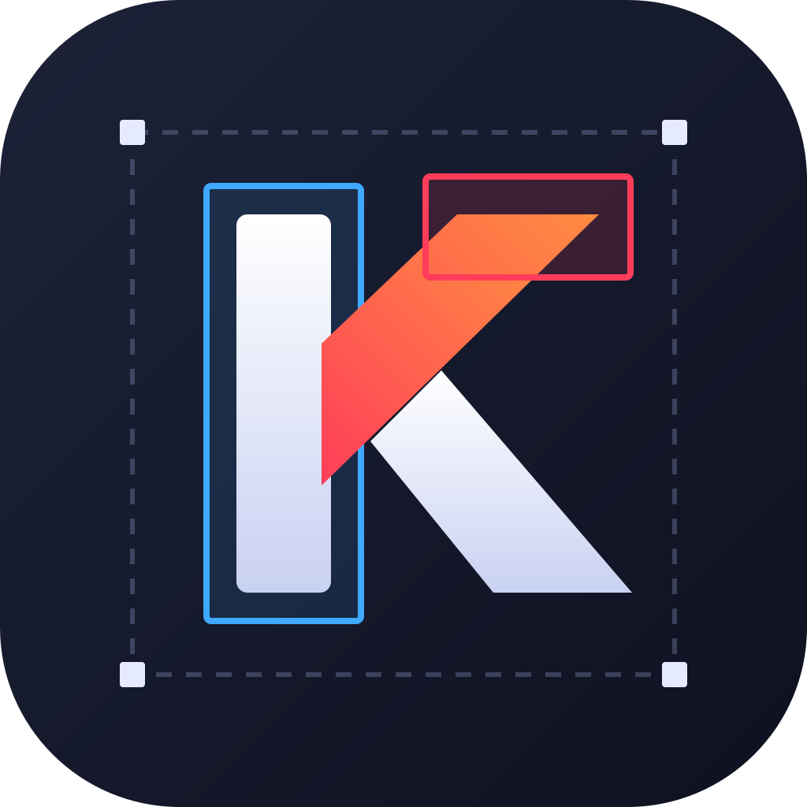

<p align="center"></p>

<h1 align="center">KataFighter</h1>

<p align="center">
  An open-source character editor for <a href="https://github.com/ikemen-engine/Ikemen-GO"><b>Ikemen GO</b></a>, built with Go and Wails v3.<br>
  <a href="https://github.com/whoisnighter/KataFighter/actions/workflows/ci.yml"></a>
</p>

KataFighter aims to be a modern, cross-platform replacement for the classic MUGEN character tools: sprites, animations and hitboxes, palettes, sounds and state code in one app, with an editor that understands CNS and ZSS. Files are read the way Ikemen GO itself reads them, because the readers are extracted from the engine's own source.

> **Status: early development.** The file readers and parsers work and are tested against the Ikemen GO release. The desktop app opens a character and reports problems in its files; the sprite and animation viewer is in progress. Nothing writes files yet. See the [roadmap](docs/PLAN.md#7-roadmap).

## What works today

| Part | What it does |
|---|---|
| [`formats/`](formats/AGENTS.md) | Go readers for **DEF**, **SFF v1/v2** (all compression modes), **AIR**, **CNS/ST/CMD** and **ZSS**, with diagnostics at `file:line:col`. Expressions parse into a syntax tree. |
| `kf` CLI | `kf inspect kfm.def` loads a whole character and lists every problem; `kf dump` exports sprites to PNG. |
| [`app/`](app/AGENTS.md) | Desktop app (Windows, macOS, Linux): open a character, browse its files, see its problems. Also runs in a browser for headless use. |
| [`tools/schemagen`](tools/AGENTS.md) | Generates the list of state controllers and triggers from the Ikemen GO source, for the coming language server. |

Every Kung Fu Man variant shipped with Ikemen GO v1.0.0 loads with zero diagnostics, and decoded sprites match Ikemen's own decoders byte for byte.

## Quick start

You need Go 1.27, Node.js 24 and the Wails CLI. [CONTRIBUTING.md](CONTRIBUTING.md) has the full setup.

```sh
git clone --recurse-submodules https://github.com/whoisnighter/KataFighter.git
cd KataFighter

# Download the Ikemen GO release used as test corpus (Kung Fu Man)
cd tools && go run ./fetchcorpus && cd ..

# Inspect a character
cd formats && go run ./cmd/kf inspect ../ikemen/release/Ikemen_GO-v1.0.0-windows/chars/kfm/kfm.def && cd ..

# Run the app
go install github.com/wailsapp/wails/v3/cmd/wails3@v3.1.0
cd app && wails3 dev
```

## Repository

| Path | What |
|---|---|
| [formats/](formats/AGENTS.md) | `katafighter-formats`: file readers and parsers |
| [app/](app/AGENTS.md) | Wails v3 desktop app (Go services + Svelte/TypeScript) |
| [lsp/](lsp/AGENTS.md) | Language server for CNS/ZSS (planned; schema already generated) |
| [tools/](tools/AGENTS.md) | Generators and the corpus downloader |
| [docs/](docs/AGENTS.md) | [Plan](docs/PLAN.md), [upstream audit](docs/upstream-audit.md), logo |
| [ikemen/](ikemen/AGENTS.md) | Pinned Ikemen GO source (submodule) and the local release build |

Each folder has an `AGENTS.md` with its rules. They are written for every contributor, human or AI agent; start from the [root one](AGENTS.md).

## Contributing

Issues and pull requests are welcome. Read [CONTRIBUTING.md](CONTRIBUTING.md) first.

## Credits and license

KataFighter is released under the [MIT License](LICENSE). It reuses code from Ikemen GO (MIT) and icons from Material Icon Theme (MIT); see [CREDITS.md](CREDITS.md).

KataFighter is an independent project and is not affiliated with the Ikemen GO team.
